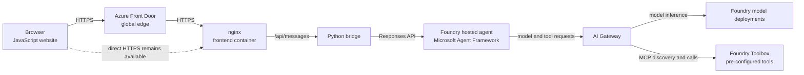

# Ski School

Ski School is a Michigan-focused skiing assistant. A JavaScript website sends
questions through a Python bridge to a Microsoft Foundry hosted agent. The
agent uses AI Gateway for model inference and controlled access to resort
research tools. Current conditions must be attributed to their sources; weather
forecasts are not resort-reported snow, lift, or trail conditions.

## Application flow

Arrows show request paths; responses return along the same paths. Tool calls
are made when needed.

## Documentation

- [Architecture and deployment boundaries](docs/architecture.md)
- Deployment scopes: [global Front Door](docs/frontdoor.md),
  [logging](docs/logging.md), [registry](docs/registry.md),
  [Foundry](docs/foundry.md), [gateway](docs/gateway.md),
  [backend](docs/backend.md), and [frontend](docs/frontend.md)
- [Delivery, state, and operational prerequisites](docs/delivery.md)
- [Historical deployment and recovery notes](infra/README.md)
- [GitHub Actions identity and release details](.github/workflows/README.md)

The documentation describes checked-in configuration, not the current health
or permissions of any Azure deployment.
