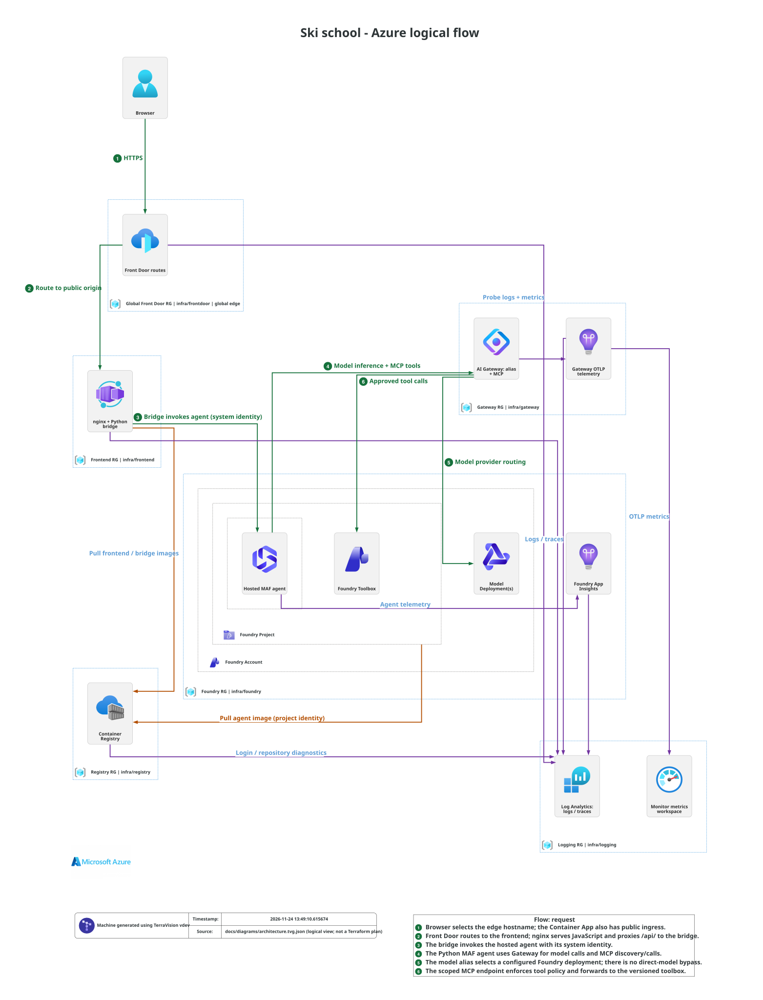

# Architecture and deployment boundaries

## Azure diagram

[Open interactive HTML diagram](diagrams/architecture.html)

This TerraVision-rendered logical view follows checked-in configuration,
not live Azure discovery or a Terraform plan. Backend's separate state remains
inside the Foundry resource group. See the [diagram sources, legend and
regeneration guide](diagrams/README.md) and each deployment page for detailed
root-specific flows.

## Application flow

When deployed and selected by a client, Azure Front Door routes the browser to
the frontend; the public Container App also remains directly reachable. The
browser loads the JavaScript website from nginx. nginx forwards `/api/`
requests to the Python bridge in the same Container App. The bridge invokes a
Foundry hosted agent with its own managed identity. The Python agent uses
Microsoft Agent Framework (MAF) and routes model requests and research-tool
discovery through AI Gateway. The configured gateway tool endpoint forwards
requests to a Foundry Toolbox with pre-configured tools. See [frontend](frontend.md),
[backend](backend.md), [gateway](gateway.md), and [Foundry](foundry.md) for
the actual interfaces and restrictions.

See the [application-flow diagram](../README.md#application-flow) for the
request paths between these components.

The agent is instructed to distinguish verified resort reports from forecasts
and general advice, include available source times, and acknowledge missing,
stale, or conflicting evidence. These instructions are safeguards, not proof
that a source or a live condition is available.

## Ownership and dependencies

The intended reason for separate resource groups is to allow independent
deployment ownership, appropriately scoped access, and eventual regional
expansion of individual application components. The specific lifecycle
advantages below are interpretations of the checked-in boundaries, not a
recorded decision for every resource.

| Deployment scope | Resource group and responsibility | Main handoffs |
| --- | --- | --- |
| [Logging](logging.md) | Shared observability workspaces, separated from consumers. | Workspace IDs to registry, Foundry, gateway, frontend and global. |
| [Registry](registry.md) | Image registry and diagnostics, separated from image consumers. | Registry ID, login server and published image digests. |
| [Foundry](foundry.md) | Account, project, model deployments, project connections, telemetry and associated grants. | Account/model details to gateway; project and telemetry details to backend. |
| [Gateway](gateway.md) | Gateway routing, aliases, tool endpoints and optional telemetry. | Alias, model endpoint and tool-server details to backend. |
| [Backend](backend.md) | Hosted-agent definition and runtime grants, in the existing Foundry project. **No dedicated resource group** is created. | Agent and published version for frontend; state and release lifecycle remain separate. |
| [Frontend](frontend.md) | Website, bridge and Container Apps runtime. | Uses the logging workspace, registry and an explicitly supplied Foundry agent ID. |
| [Global Front Door](frontdoor.md) | Shared edge infrastructure in a separate resource group per environment, outside the regional frontend lifecycle: profiles, endpoints, origin groups, origins, routes and diagnostics. | Reads the existing frontend ingress and sends diagnostics to the shared Log Analytics workspace; returns endpoint hostnames for the frontend allowlist. |

These seven Terraform roots have separate state, but are not independent of each
other. Inputs and outputs are supplied explicitly: there is no automatic
cross-root orchestration. Modules under `infra/modules/` are reusable
implementation units, not separate deployment scopes. A typical dependency
order is logging, registry and Foundry, gateway, backend release, frontend, then
global. The generated Front Door hostname must also be reconciled with the
frontend's allowlist after it is known. Check each root's prerequisites and
grants before proceeding. Foundry and gateway identity handoffs can require
staged changes.

## Global Front Door

Front Door belongs to shared infrastructure, rather than a regional application
deployment. Its Azure global edge scope does not imply cross-environment
sharing: dev targets a dev-specific resource group and one frontend origin,
with separate state storage per environment. No multi-region origin deployment
is configured. See [scope and sharing](frontdoor.md#shared-scope-and-lifecycle)
for the configuration evidence and Azure scope references.

[`infra/frontdoor`](../infra/frontdoor/) owns its resource group and the Front Door
resources, not the frontend app or logging workspace. The separate state and
resource group permit edge configuration to be managed independently of an
application image release; that lifecycle rationale is an inference from the
boundary, not a recorded design decision. Replacing or retiring an endpoint
can interrupt edge traffic and invalidate the frontend allowlist. Retiring
the edge does not itself retire the frontend, but clients using its hostname
need another path. A frontend ingress or workspace change can break the edge
even though their state is separate. See the [Front Door deployment scope](frontdoor.md)
for routing, telemetry, state and delivery details.

## Environments, regions and state

Root-specific, environment-neutral state keys are reused across separate
environment storage accounts. Backend initialization settings are separate
from `.tfvars` inputs. Current caller workflows select `dev`; a reusable
environment matrix does not itself configure another deployment. State
bootstrap ownership and any migration must be planned and approved separately.
See [delivery and state](delivery.md).

Checked-in dev inputs place the logging resource group and the registry,
Foundry, and frontend in North Central US; the logging workspaces and gateway
are in East US 2; the global edge has no regional frontend replica. Different
resource locations do not constitute regional replicas. Independent regional
scaling is a design goal, not an implemented
multi-region or disaster-recovery strategy. Extra regional instances require
explicit regional frontend and dependent service targets, state and cross-root
handoffs, verified regional support and quotas, additional origin configuration,
and a separately designed traffic, data replication and failover strategy.
Adding a hostname alone does not provision a replica or establish its readiness.

References: [Azure resource groups](https://learn.microsoft.com/en-us/azure/azure-resource-manager/management/manage-resource-groups-portal),
[Terraform backends](https://developer.hashicorp.com/terraform/language/state/backends),
and [Azure regions and availability zones](https://learn.microsoft.com/en-us/azure/well-architected/design-guides/regions-availability-zones).
