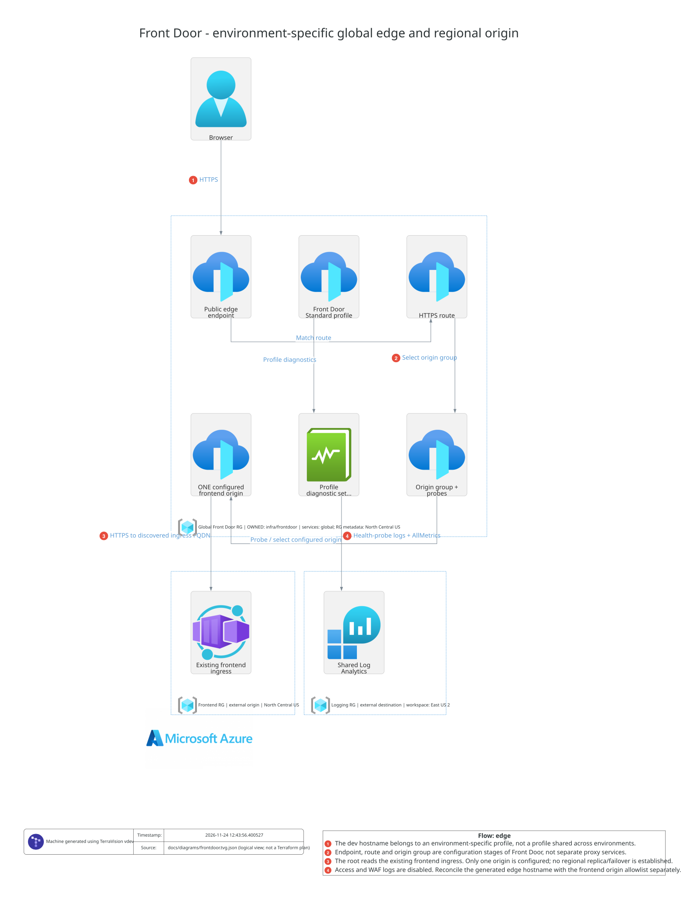

# Front Door deployment scope

[`infra/frontdoor`](../infra/frontdoor/) owns a separate global resource group for
Azure Front Door profiles, endpoints, origin groups, origins, routes and
diagnostic settings. It does not own the frontend app or logging workspace.
The checked-in [dev inputs](../infra/frontdoor/dev.tfvars) name the group
`rg-ski-global-dev-gbl`. Its North Central US location is resource-group
metadata; the Front Door profile and endpoint are configured as `global`.

## Azure diagram

[Open interactive HTML diagram](diagrams/frontdoor.html)

The routing stages are logical configuration within Front Door, not separate
network hops. The regional frontend remains in its own resource group.
See the [diagram legend and sources](diagrams/README.md).

## Shared scope and lifecycle

Front Door is **shared edge infrastructure within an environment**, separate
from the regional frontend's compute and application-image lifecycle. This
classification does not mean that multiple environments currently share one
profile. The [dev inputs](../infra/frontdoor/dev.tfvars) select dev-specific
resource names and one dev frontend, and the [backend](../infra/frontdoor/backend.tf)
documents environment-isolated state storage. The root is reused across
environments; its state and resources are not automatically shared across them.

Azure's **global** scope is a different concern: Front Door uses a
[global edge network](https://learn.microsoft.com/en-us/azure/frontdoor/front-door-overview),
while the resource-group location determines where its
[metadata is stored](https://learn.microsoft.com/en-us/azure/azure-resource-manager/management/manage-resource-groups-portal#what-is-a-resource-group).
The [profile](../infra/modules/frontdoor-profile/main.tf) and
[endpoint](../infra/modules/frontdoor-endpoint/main.tf) explicitly set
`location = "global"`. This is not a regional frontend replica or evidence
of multi-region failover. The root supports additional origins, but dev
configures only one; adding regions requires separately provisioned regional
origins and dependencies, explicit origin configuration, and a designed
replication and failover strategy.

The [root](../infra/frontdoor/main.tf) owns the edge resource group and all its
profiles and routing resources together in one state. Edge changes can be
planned separately from frontend image releases, but affect every endpoint
and origin using the changed profile or origin group. That lifecycle rationale
is an inference from the code boundary, not a recorded design decision.
Retiring the edge does not retire the separately owned frontend or logging
workspace; clients still need a working entry point. Conversely, changes to
the frontend ingress, its origin allowlist, or the logging workspace require
coordination despite separate state. See [state and delivery](#state-and-delivery)
for endpoint replacement and release boundaries.

## Profiles and routing

The root takes explicit tenant, subscription, resource-group and workspace
IDs, an existing frontend Container App ID, and a `profiles` map. It reads and
validates the app's public ingress hostname through Azure, not frontend state,
even when a profile does not use that frontend. See
[`data.tf`](../infra/frontdoor/data.tf),
[`variables.tf`](../infra/frontdoor/variables.tf),
[`main.tf`](../infra/frontdoor/main.tf), and
[`outputs.tf`](../infra/frontdoor/outputs.tf). The read uses
[`Microsoft.App/containerApps@2026-07-01`](https://learn.microsoft.com/en-us/azure/templates/microsoft.app/2026-07-01/containerapps).

One deployment can define multiple Standard profiles and endpoints. Each
profile has one origin group shared by its endpoints; optional additional
origins have configurable hostnames, priorities and weights. Dev configures one
profile, one endpoint and one frontend origin. When that origin is eligible,
it receives all origin-directed traffic. With more origins, selection depends
on health, priority, latency and weight; weights are not guaranteed traffic
percentages. Additional origins alone do not provision regional replicas,
replicate data or demonstrate failover.

Each [route](../infra/modules/frontdoor-route/main.tf) links the default domain,
matches `/*`, accepts HTTP and HTTPS, redirects HTTP to HTTPS, and forwards
to the origin over HTTPS. Caching, custom domains, a WAF policy and private
origin connections are not configured. The
[origin](../infra/modules/frontdoor-origin/main.tf) sends the origin hostname
as `Host` and enables certificate-name checking against that hostname. The
frontend Container App remains publicly reachable directly; the bridge's
origin allowlist is not network access control. See
[frontend origins](frontend.md#front-door-and-browser-origins), Microsoft's
[origin guidance](https://learn.microsoft.com/en-us/azure/frontdoor/origin),
[routing methods](https://learn.microsoft.com/en-us/azure/frontdoor/routing-methods),
and [caching guidance](https://learn.microsoft.com/en-us/azure/frontdoor/front-door-caching).

## Health and telemetry

The [origin group](../infra/modules/frontdoor-origin-group/main.tf) uses HTTPS
`GET /healthz` and disables session affinity. Dev configures a 240-second probe
interval, four samples, three required successes and zero additional latency.
The profile's origin response timeout is 240 seconds. The
[bridge health endpoint](../src/frontend/bridge/main.py) returns `ok` but does
not check the agent or model, so the probe is not end-to-end readiness. See
Microsoft's [health-probe behavior](https://learn.microsoft.com/en-us/azure/frontdoor/health-probes).

Each profile's [diagnostic setting](../infra/frontdoor/main.tf) enables
`FrontDoorHealthProbeLog` and `AllMetrics` to the existing Log Analytics
workspace, and explicitly disables `FrontDoorAccessLog` and
`FrontDoorWebApplicationFirewallLog`. This is not access or WAF request
logging, nor proof that telemetry is arriving. See
[Front Door monitoring](https://learn.microsoft.com/en-us/azure/frontdoor/front-door-diagnostics)
and the [diagnostic setting contract](https://learn.microsoft.com/en-us/azure/templates/microsoft.insights/2021-05-01-preview/diagnosticsettings).

## State and delivery

The root uses `ski-school-global.tfstate` in an environment-isolated backend;
backend settings are supplied separately from `.tfvars`. Renaming the root
does not change that key or migrate state. Initialize the renamed directory
against the existing backend only with appropriate approval. Outputs include
the resource-group ID and Azure-generated `default_hostnames` keyed by profile
and endpoint. Compare these hostnames with the separately configured
`bridge_allowed_origins` before serving edge-hosted message requests. Replacing
an endpoint can interrupt traffic or invalidate that allowlist; a global-only
change does not automatically deploy the frontend.

The [Front Door CI and CD workflows](delivery.md#front-door-ci-and-opt-in-cd) check
the global root. The CD deployment job is opt-in via
`ENABLE_GLOBAL_FRONT_DOOR_DEPLOYMENT`; neither a workflow configuration nor a
Terraform output proves a deployment succeeded. See [delivery](delivery.md)
for state, prerequisites and approval requirements.

The Front Door modules specify `Microsoft.Cdn` API `2026-10-01` and the root
locks [AzAPI 2.14.0](../infra/frontdoor/.terraform.lock.hcl). The
[versioned AzAPI resource reference](https://registry.terraform.io/providers/Azure/azapi/2.14.0/docs/resources/resource)
describes provider behavior, but a matching official `2026-10-01` Front Door
resource contract could not be verified in the accessible Microsoft Learn
references. Confirm that contract and provider compatibility before relying
on these settings; service guidance above is not a substitute for that API
contract.
