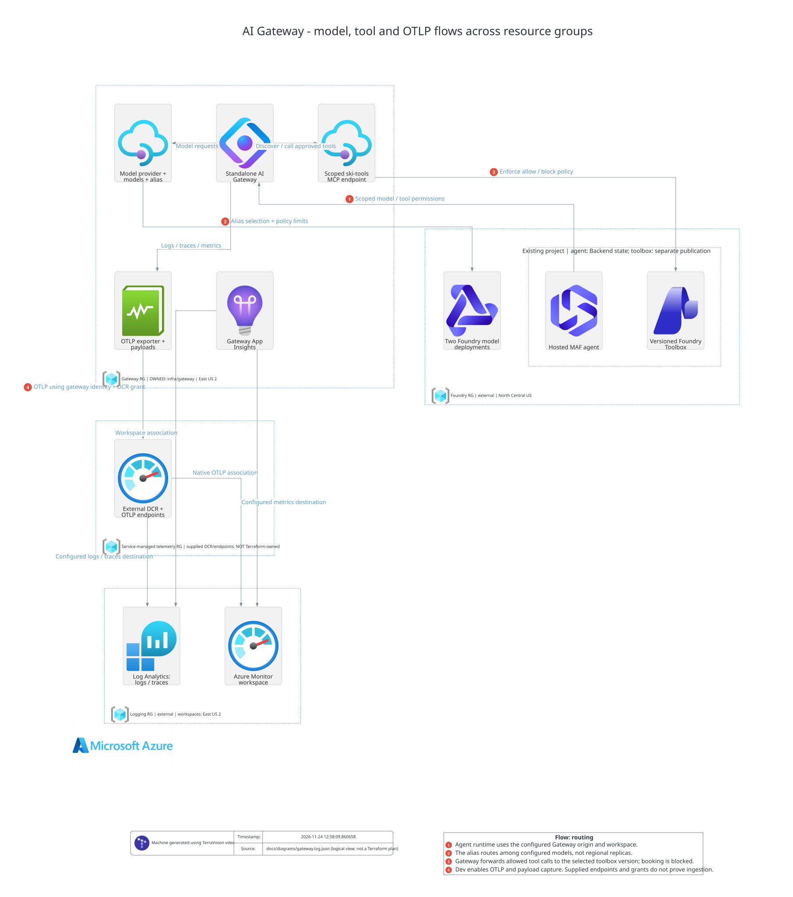

# Gateway deployment scope

[`infra/gateway`](../infra/gateway/) owns a resource group for AI Gateway,
model provider and model registrations, an alias, MCP tool endpoints and
optional telemetry. This isolates gateway configuration and access policy from
the Foundry account and agent release, while both remain dependencies.

## Azure diagram

[Open interactive HTML diagram](diagrams/gateway.html)

The external service-managed telemetry group is not provisioned by this root.
API Management icons represent gateway alias and MCP configuration, not an
additional APIM service. See the [diagram legend and sources](diagrams/README.md).

## Routing, tools and access

- The root consumes Foundry account, endpoint and model deployment details;
  it configures model entries and an alias with routing/selection settings and
  optional limits. Its outputs include the gateway hostname, alias ID and name,
  model IDs, and MCP endpoint URLs.
- `mcp_endpoints` defines backend URLs, allowed and blocked tools, supported
  protocol versions and token audiences. In the checked-in dev inputs the
  `ski-tools` endpoint forwards to a versioned Foundry toolbox; resort search
  and lookup are allowed and lodging booking is blocked. Gateway owns tool
  approval/denial; the agent discovers tools rather than maintaining another
  per-tool allowlist.
- The gateway's system identity needs the appropriate Foundry access; callers
  need scoped model and tool-server permissions. The backend root manages its
  agent's corresponding grants. Do not treat gateway deployment alone as proof
  of working inference or tool access.

## Observability and lifecycle

Optional Application Insights and exporter resources use explicitly supplied
workspace and telemetry settings. The checked-in dev inputs enable native
OTLP and gateway payload capture. Payloads may include prompts, completions
and tool data: assess access and retention before enabling or changing it.
Agent-side content capture settings do not disable gateway payload capture.
Configured exporters do not prove successful ingestion.

The gateway consumes Foundry and logging handoffs; the backend consumes gateway
endpoints and IDs. Changes or replacement can interrupt agent inference or tool
discovery even when backend state is unchanged. The state key is
`ski-school-gateway.tfstate`. The dev inputs place this scope in East US 2.
Gateway API and local provider-schema exceptions must be reviewed per resource
contract; do not infer support from another resource's contract.

References: [AI Gateway documentation](https://ai.gateway.azure.com/docs) and
the [2026-11-01 parent gateway resource contract](https://learn.microsoft.com/en-us/rest/api/aigateway/ai-gateway-resources/create-or-update?view=rest-aigateway-2026-11-01).
The interactive documentation may not expose all child-contract details to
automated readers; unavailable evidence must not be replaced with guesses.
