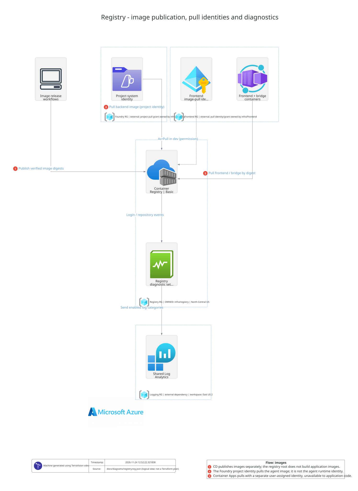

# Registry deployment scope

[`infra/registry`](../infra/registry/) owns a container registry, its resource
group, and diagnostic settings. Keeping image storage separate from the
frontend and hosted-agent lifecycles permits independently managed image
publication and access. Existing consumers remain dependent on its repositories
and retained image digests.

## Azure diagram

[Open interactive HTML diagram](diagrams/registry.html)

Publication, project image pulls and frontend image pulls have distinct owners
and identities. External resource-group boxes are dependencies, not resources
owned by this root. See the [diagram legend and sources](diagrams/README.md).

## Configuration and handoffs

- `registry_sku_name` selects the SKU; `workspace_id` supplies the logging
  root's Log Analytics workspace for registry diagnostics.
- Outputs include `registry_id`, `registry_login_server`, and
  `resource_group_id`. The Foundry root optionally connects the project to the
  registry and grants its project identity image-pull access. The frontend
  root manages a distinct image-pull identity and registry grant.
- The [dev inputs](../infra/registry/dev.tfvars) select Basic in North Central
  US and login and repository event categories. The registry module disables
  admin and anonymous pulls, enables public network access, and configures
  legacy registry permissions. Foundry and frontend consumers inspect the
  registry's reported permission mode when selecting their pull grants.

Backend and frontend CI build image artifacts; CD publishes the verified images
and passes registry digests to their Terraform roots. The deployment identity
that pushes images, Foundry project pull identity, and frontend pull identity
are distinct. Registry permission mode determines which pull role and, where
applicable, repository condition are used; see
[workflow identity details](../.github/workflows/README.md#separate-workload-identities).

The root uses `ski-school-registry.tfstate`. Deploy logging first, and inspect
image consumers and permissions before changing or retiring the registry.
See [delivery](delivery.md) for approval and state prerequisites.

Reference: [ACR roles and permission modes](https://learn.microsoft.com/en-us/azure/container-registry/container-registry-rbac-built-in-roles-overview).
