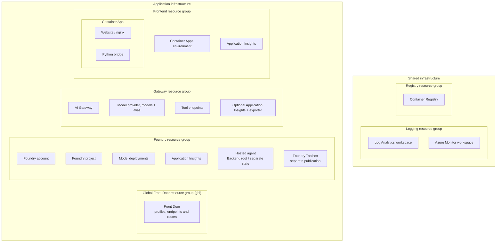

# Historical deployment and recovery notes

For the current documentation index, see the [project README](../README.md).
The [architecture](../docs/architecture.md), individual deployment-scope
pages, and [delivery guide](../docs/delivery.md) describe the checked-in
configuration. Initial deployment and recovery accounts below are historical
observations, not proof of current resources, health, role assignments, state
migration, or telemetry ingestion.

## Architecture and deployment boundaries

This repository separates infrastructure by resource-group ownership and change
lifecycle, with an independent Terraform root and state for each deployment
boundary. The separation allows a root to be planned and applied without
replanning every resource in the website, but it does not remove dependencies
between roots. The rationale below combines the confirmed intent of independent deployment
ownership, appropriately scoped access and eventual regional expansion with
inferences from checked-in Terraform. There is no architecture decision record
establishing every component-specific choice.

The map uses resource groups as boundaries and shows their main components.
Shared infrastructure is grouped separately from the application infrastructure.
The map shows resource placement rather than communication; see the
[application flow](../README.md#application-flow) and the cross-group Terraform
inputs in the table below.

The logging, registry, Foundry, gateway, frontend and global Front Door resource
groups each have their own Terraform root and state. Backend has separate state
but manages its hosted agent in the Foundry project, not a separate resource
group. Toolbox publication is separate from Terraform. Some roots also manage
role assignments outside their resource group.

Logging workspace IDs are supplied to Registry, Foundry, Gateway, Frontend and
Global. The registry supplies image-pull access and published image digests;
Foundry supplies the project and model details; Gateway supplies the backend's
model alias and tool endpoints. Frontend receives the agent ID as an explicit
input, not a Backend Terraform output. Global reads the frontend ingress and
outputs edge hostnames; the frontend's origin allowlist is configured separately.
The table below describes these handoffs.

| Terraform root | Ownership and reason for the boundary | Cross-root contract and lifecycle consideration |
| --- | --- | --- |
| [`infra/logging`](./logging/) | Owns the logging resource group, Log Analytics workspace, and Azure Monitor workspace. These are shared observability services, not part of an individual app or model release. The workspaces can be in different regions, so root location alone does not determine every resource's region. | Exposes separate workspace IDs for consumers. Registry, Foundry, Gateway, Frontend, and Global receive explicit workspace IDs. Consumers and diagnostic settings must be accounted for before retiring a workspace. |
| [`infra/registry`](./registry/) | Owns the registry resource group, image registry, and its diagnostic settings. The registry lifecycle is separate from application compute and agent configuration; the same registry can hold independently versioned images. | Exposes the registry ID and login server. Foundry owns the project image-pull connection and grant; Backend and Frontend release workflows publish immutable image digests. Retire only after image consumers and releases no longer depend on it. |
| [`infra/foundry`](./foundry/) | Owns the Foundry account resource group, account, project, model deployments, Application Insights component, account diagnostics, and project-level connections and grants managed by this foundation root. This keeps the account/project foundation and its model configuration together while allowing Gateway and agent releases to change separately. | Receives logging and optional registry inputs. Exposes account, project, model, and telemetry identifiers used by Gateway and Backend. Downstream roots can be independent in state and deployment, but not independent of these resources. |
| [`infra/gateway`](./gateway/) | Owns the AI Gateway resource group and the gateway routes, model aliases, MCP endpoints, and optional gateway telemetry configuration. This gives gateway policy and routing a separate change and state boundary from the Foundry account and hosted agent. | Receives the Foundry model provider details and logging inputs; emits alias and endpoint identifiers used by Backend. Gateway deletion or replacement can affect agent model/tool access even though the agent has separate state. |
| [`infra/backend`](./backend/) | Owns the hosted-agent release resource and its runtime grants in Foundry. It does not create a dedicated Azure resource group. Its state and release flow separate application/agent versions from Foundry account and project foundation changes. | Consumes the existing Foundry project, Gateway alias/tool servers, and a published registry image digest. Backend CD validates a candidate version and promotes traffic only after its readiness check; this is a distinct lifecycle from the reusable Terraform apply. |
| [`infra/frontend`](./frontend/) | Owns the frontend hosting resource group and Container Apps runtime. Keeping the public website runtime separate from the Foundry account and agent release limits unrelated infrastructure plans and lifecycle changes. | Consumes the existing Foundry hosted agent, registry, and logging workspace. The agent resource ID is explicitly supplied in the Frontend root's environment configuration; Backend does not currently export it as a Terraform output. Frontend CD publishes verified frontend and bridge images, then deploys their digests through the shared Terraform deployment workflow. |
| [`infra/global`](./global/) | Owns the global Front Door resource group, profiles, endpoints, origin groups, origins, routes, and diagnostic settings in separate state. | Reads the existing frontend ingress, sends diagnostics to Log Analytics, and outputs endpoint hostnames. Coordinate the frontend origin allowlist separately; see [global Front Door](../docs/frontdoor.md). |

Reusable modules under [`infra/modules`](./modules/) are implementation building
blocks, not deployment roots or independent state boundaries. Each module's
resources belong to the state of the root that calls it.

### State, regions, and independent deployment

- Each root has its own remote Terraform state key. Backend initialization
  settings are supplied separately from that root's `.tfvars`; state is not
  shared automatically between roots. Root outputs and explicit input values
  form the handoff contract.
- The CI/CD caller manifests currently select `dev`. They pass one root-specific
  state key and an environment/backend target to reusable checks and deploy
  workflows. The reusable workflows can matrix over distinct environments,
  but the checked-in callers do not define a regional target matrix.
- Several roots expose location inputs, with per-root validation that can
  constrain supported regions; selected components also have separate
  location inputs. In current dev inputs,
  the Logging resource group is in North Central US while both workspace
  locations are East US 2; Foundry is in North Central US and Gateway is in
  East US 2. These placements do not represent redundant regional copies.
  The Log Analytics location differs from its variable description in
  `infra/logging/variables.tf`; the overview follows the explicit dev input.
- Front Door configures routing to origins, but the checked-in configuration
  does not establish region-by-region application replicas, data replication,
  or regional failover. It is not a deployed multi-region or disaster-recovery
  architecture. Supporting multiple regional instances independently would
  require explicit regional target/state identities and cross-root handoffs;
  those are not currently defined here.

### GitHub Actions delivery map

The root-specific CI/CD entry points are:

| Deployment | Pull request checks | Main-branch release |
| --- | --- | --- |
| Logging | [`logging-ci.yml`](../.github/workflows/logging-ci.yml) | [`logging-cd.yml`](../.github/workflows/logging-cd.yml) |
| Registry | [`registry-ci.yml`](../.github/workflows/registry-ci.yml) | [`registry-cd.yml`](../.github/workflows/registry-cd.yml) |
| Foundry | [`foundry-ci.yml`](../.github/workflows/foundry-ci.yml) | [`foundry-cd.yml`](../.github/workflows/foundry-cd.yml), which deploys a separately packaged toolbox artifact after Terraform succeeds |
| Gateway | [`gateway-ci.yml`](../.github/workflows/gateway-ci.yml) | [`gateway-cd.yml`](../.github/workflows/gateway-cd.yml) |
| Backend agent | [`backend-ci.yml`](../.github/workflows/backend-ci.yml) | [`backend-cd.yml`](../.github/workflows/backend-cd.yml), including candidate readiness and version promotion |
| Frontend | [`frontend-ci.yml`](../.github/workflows/frontend-ci.yml) | [`frontend-cd.yml`](../.github/workflows/frontend-cd.yml), including verified image publication |
| Global Front Door | [`frontdoor-ci.yml`](../.github/workflows/frontdoor-ci.yml) | [`frontdoor-cd.yml`](../.github/workflows/frontdoor-cd.yml), with an opt-in deployment gate |

For Terraform roots, the common path-filtered workflows call
[`reusable-terraform-checks.yml`](../.github/workflows/reusable-terraform-checks.yml),
which calls the reusable module and Terraform plan workflows. On eligible pull
requests and main pushes, validation and planning use the selected remote state.
The main-branch deploy workflow verifies the immutable source and module
artifacts from that run, then makes a fresh plan before applying. A no-change
plan skips apply. Backend and Frontend add image build, publication, and
runtime-specific release checks. Foundry packages toolbox source separately
and deploys it after its Terraform deployment succeeds. Global deployment
requires the opt-in described in [Front Door delivery](../docs/delivery.md#front-door-ci-and-opt-in-cd).
These are configuration-level descriptions, not evidence that any particular
run succeeded.

The workflows are path-filtered; their own comments caution against making
them unconditional required checks for every pull request. The repository
configuration here does not establish which branch rules or required status
checks are enabled. See [workflow identity and release details](../.github/workflows/README.md)
for OIDC, role scopes, workload identities, state prerequisites, and the
Backend promotion sequence.

### Architecture references

- [Azure resource groups and lifecycle management](https://learn.microsoft.com/en-us/azure/azure-resource-manager/management/manage-resource-groups-portal)
- [Azure regions and availability zones](https://learn.microsoft.com/en-us/azure/well-architected/design-guides/regions-availability-zones)
- [Terraform remote state and team handoffs](https://developer.hashicorp.com/terraform/language/state/remote)
- [Terraform state backends](https://developer.hashicorp.com/terraform/language/state/backends)
- [Terraform Azure Blob backend](https://developer.hashicorp.com/terraform/language/backend/azurerm)
- [Azure/azapi provider reference](https://registry.terraform.io/providers/Azure/azapi/latest/docs)
- [Foundry project ARM resource, API version 2026-05-15-preview](https://learn.microsoft.com/en-us/azure/templates/microsoft.cognitiveservices/2026-05-15-preview/accounts/projects)
- [Foundry hosted-agent management and REST operations](https://learn.microsoft.com/en-us/azure/foundry/agents/how-to/manage-hosted-agent)
- [Foundry REST reference](https://learn.microsoft.com/en-us/azure/foundry/reference/rest/)
- [AI Gateway documentation](https://ai.gateway.azure.com/docs)
- [AI Gateway parent resource REST contract, API version 2026-11-01](https://learn.microsoft.com/en-us/rest/api/aigateway/ai-gateway-resources/create-or-update?view=rest-aigateway-2026-11-01)

## Initial infrastructure deployment

The Terraform roots in this directory have separate state. Except for Backend,
each owns a separate resource group.
The initial dev deployment uses the existing logging and registry roots before
Foundry. The gateway is a later stage; a gateway resource alone does not create
a usable Foundry model connection. Publishing an agent and its image is also a
separate lifecycle from provisioning these roots.

## Prerequisites and state

- Install Azure CLI and Terraform `>= 1.11, < 2.0`. Each root pins AzAPI in its
  checked-in lockfile. Sign in with `az login` (or `az login --use-device-code`
  on a remote host), select the intended subscription, and verify the tenant.
- Pass the root's explicit `dev.tfvars` with `-var-file=dev.tfvars`. The
  checked-in `dev.tfvars` files contain non-secret configuration; other
  environment inputs may need to be created from that root's example where
  provided. Supply target and dependency values explicitly. Do not put
  credentials in these files. Terraform does not automatically load `.tfvars`
  files unless named for auto-loading.
- The backend settings are separate from variables. Where a root provides
  `dev.backend.hcl.example`, use it to prepare an ignored `dev.backend.hcl`;
  the frontend root does not currently have an example. Verify the storage
  coordinates and matching isolated state key. Do not copy credentials into
  either file or commit state, plans, or `.terraform/`.
- The existing dev backend was already provisioned before these deployments;
  its bootstrap configuration and state ownership are not established in this
  repository. Before a new bootstrap or migration, agree on how the backend
  infrastructure itself is managed, how initial state is encrypted and secured,
  and how it will be migrated to locked remote state. Obtain explicit approval;
  never fall back silently to local state.
- The backend uses Microsoft Entra data-plane authentication and Azure Blob
  leases for locking. The existing account has encryption and HTTPS enabled,
  and shared-key access disabled. For a new environment verify these controls,
  access, key ownership, and network policy before initialization. HashiCorp
  recommends **Storage Blob Data Contributor** at the container scope for state
  access; the initial dev operator had an existing assignment at storage-account
  scope. No backend role was granted as part of these deployments.
- Check the appropriate resource providers are registered and that the deployer
  has the required resource and diagnostic-setting actions at their actual
  scopes. Provider auto-registration is disabled in the roots. Registration,
  role grants, bootstrap and other cloud writes require separate approval.

Before backend initialization or any apply, identify the tenant, subscription,
resource group and environment, review the effects and costs, and obtain
explicit approval for that operation. For each root, initialize the approved
remote backend with `terraform init -backend-config=dev.backend.hcl
-lockfile=readonly`, validate, and generate a saved plan with the explicit dev
variable file. Review and approve the exact plan before applying it. Stop for
unexpected changes, replacement, deletion, conflicts, or target differences.

## Initial dev sequence

This sequence records the initial deployment, not current configuration or
live status. Consult each linked [deployment scope](../README.md#documentation)
and its current `.tfvars` before planning further work.

1. **Logging (`logging`)**: The resource group is in North Central US. The
   explicit dev inputs place both Log Analytics and Azure Monitor workspaces
   in East US 2. The existing deployment note records the Monitor workspace's
   East US 2 placement as a provider-metadata constraint for North Central US;
   the Log Analytics region is an explicit dev override, with no separate
   rationale recorded. Set `monitor_workspace_location = "eastus2"` explicitly.
   Azure also creates a
   service-managed resource group, data collection rule and endpoint for the
   Monitor workspace. The Log Analytics workspace uses 30-day retention,
   resource-context access and disabled local authentication.
2. **Registry (`registry`)**: deploy the Basic registry in North Central US
   and pass the logging root's Log Analytics `workspace_id` output explicitly.
   The registry uses public network access, with admin and anonymous pulls
   disabled. Audit diagnostics send login and repository events to Log
   Analytics. Azure returns disabled `AllMetrics` in the diagnostic setting;
   the module explicitly models it as disabled to avoid recurring drift.
3. **Foundry (`foundry`)**: provide the Log Analytics workspace ID and an
   explicitly verified model version, deployment type and capacity. Dev
   selected `gpt-5.4-mini` version `2026-03-17`, GlobalStandard capacity `10`.
   Recheck region, quota and pricing for the target before each deployment.
   GlobalStandard can process inference outside the resource region.
   Dev keeps `native_otlp_enabled = false` because native OTLP across the
   existing workspace regions remains unverified. The dev project has a
   project-managed-identity tracing connection to the deployed Log
   Analytics-backed Application Insights component. Azure returned the
   configured connection properties, but actual trace ingestion has not been
   verified. Foundry Audit diagnostics are also deployed. Azure returns other
   log categories and `AllMetrics` disabled; the diagnostic setting models
   these explicitly without enabling request, response or trace capture.
4. **Gateway (`gateway`)**: the dev gateway foundation is in East US 2 with
   public backend routing and a system-assigned identity. Azure rejected the
   example `AIGateway` SKU during the first apply and required `Standard`;
   the approved recovery created the gateway using that SKU. The gateway now
   has Foundry access, a registered model and alias, and a configured OpenTelemetry
   exporter. Dev explicitly enables payload capture; end-to-end telemetry ingestion
   and cross-region inference remain unverified, and caller authorization remains
   deferred.

## Initial identity and role boundaries

These are historical observations; current Terraform may manage additional
grants. Verify the applicable root and the actual target before acting.

- Do not use keys as an authentication fallback or grant broad roles to bypass
  missing access. Separate the deployment operator, gateway, project, hosted
  agent, image-pull and telemetry identities. A system-assigned identity is the
  preferred Azure workload identity where the specific integration supports it.
- The logging and registry deployments did **not** create workload role
  assignments. Registry image-pull access was deliberately deferred; do not
  assume the Foundry account identity is the image-pull principal. Microsoft's
  hosted-agent guidance identifies the project managed identity for image pulls
  and a separate agent identity for code execution. Verify the registry
  permission mode, exact role and scope, and project connection before granting
  access. Build/push and hosted-agent publication are not part of these roots.
- The Foundry root can grant **Foundry User**, the role used by Microsoft's
  gateway integration, to an explicitly supplied gateway identity at the
  Foundry account scope. Dev has this grant deployed to the gateway identity.
  The existing narrower
  **Cognitive Services OpenAI User** option is retained; don't assign both to
  the same gateway. The gateway root can grant **AI Gateway Models User** to
  an explicitly supplied caller at the model alias scope.
- The project identity has **Monitoring Metrics Publisher** on the Foundry
  Application Insights component, managed by the Foundry root. The dev tracing
  connection is deployed, but actual ingestion remains unverified. Microsoft's
  tracing guidance specifies a separate publisher grant
  for the hosted-agent identity when its code emits traces; that grant remains
  deferred. Traces can contain prompts, outputs and tool data; review redaction
  and retention before enabling them. The gateway exporter also supports payload
  capture; the dev setting captures prompts, completions, and tool input/output,
  with no built-in PII redaction. Review the telemetry destination's access and
  retention controls.

## Deployment notes and recovery

- Azure CLI sign-in and the existing backend use identity-based access.
  Backend configuration and secret inputs are not suitable for source control;
  handle them securely. The checked-in `dev.tfvars` files are non-secret
  environment configuration.
- The first Foundry apply was **partial**: the resource group, account, model
  deployment and Audit diagnostic were created. Azure rejected the Application
  Insights preview API, and project creation encountered a concurrent
  account-operation conflict. The approved recovery used the supported
  `2020-02-02` Application Insights API with native OTLP disabled and created
  both missing resources after the account operation completed. The account,
  project, model and Application Insights component reported `Succeeded`, and
  the follow-up plan showed no changes. For future recovery, inspect resources
  and remote state and review a new plan; do not remove state, force-unlock, or
  delete resources as a shortcut.
- The native OTLP opt-out and tracing-connection opt-out are independent.
  Disabling an existing project connection can plan its removal; native OTLP
  cannot necessarily be disabled after it is enabled. Review changes carefully
  when modifying existing environments.
- The project connection uses `ProjectManagedIdentity` and Microsoft sample
  destination metadata; its narrowly approved AzAPI schema exception leaves
  server-side validation in place. The Application Insights connection string
  is destination metadata, not an authentication fallback. Terraform reads it
  from the component and stores that provider response in encrypted remote
  state; restrict state access. The connection's write-only sensitive body
  avoids persisting another copy there. Increment
  `application_insights_metadata_version` if that metadata changes.
- The gateway's initial apply created its resource group but failed on the SKU;
  the reviewed recovery plan created the gateway with `Standard`. The gateway
  reported `Succeeded` and its follow-up plan showed no changes. Its remote
  state used an earlier key at that time; current workflow configuration uses
  `ski-school-gateway.tfstate`. The subsequent approved
  model-route apply created a Foundry provider, model and Responses alias;
  Azure returned their configured properties and the follow-up plan showed no
  changes. No caller grant or end-to-end inference test has been completed.
- An earlier model-route attempt failed during a provider GET before creating
  the provider, model or alias. The historical recovery used individually
  approved local schema exceptions and retained server-side validation.
  Gateway modules and API versions have since changed; inspect the current
  module configuration and approved contract-specific exceptions rather than
  treating that recovery as current guidance. The approved evidence sources
  are listed in the [gateway guide](../docs/gateway.md).

## References

- [Terraform Azure Blob backend and Entra authentication](https://developer.hashicorp.com/terraform/language/backend/azurerm)
- [Azure Monitor workspace managed resources](https://learn.microsoft.com/en-us/azure/azure-monitor/metrics/azure-monitor-workspace-manage)
- [Azure Monitor OTLP setup and region guidance](https://learn.microsoft.com/en-us/azure/azure-monitor/containers/opentelemetry-protocol-ingestion)
- [Foundry quota and deployment capacity](https://learn.microsoft.com/en-us/azure/foundry/openai/how-to/quota)
- [Hosted-agent deployment and identities](https://learn.microsoft.com/en-us/azure/foundry/agents/how-to/deploy-hosted-agent)
- [Foundry tracing with Microsoft Entra authentication](https://learn.microsoft.com/en-us/azure/foundry/observability/how-to/trace-ingestion-entra-authentication)
